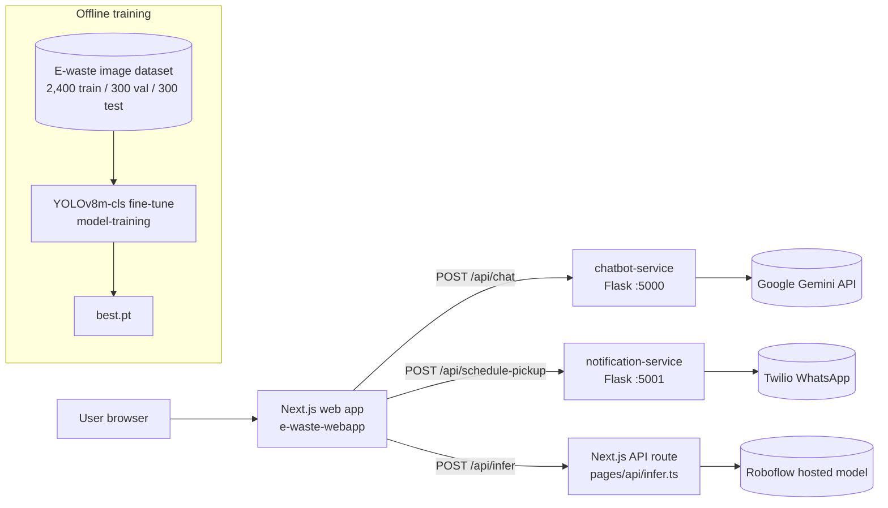
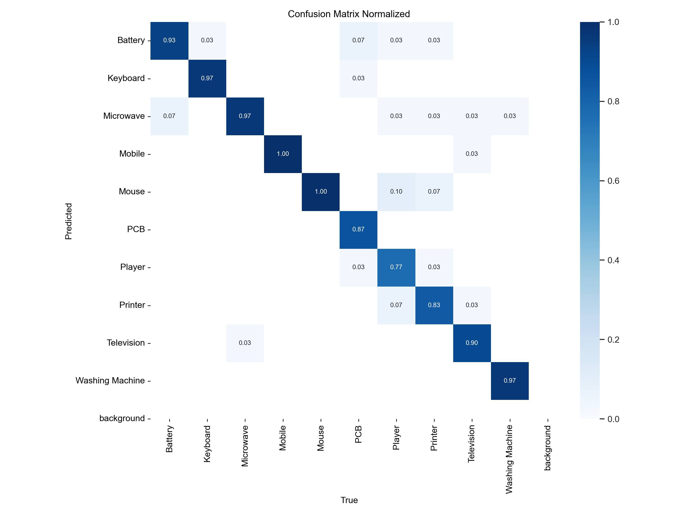
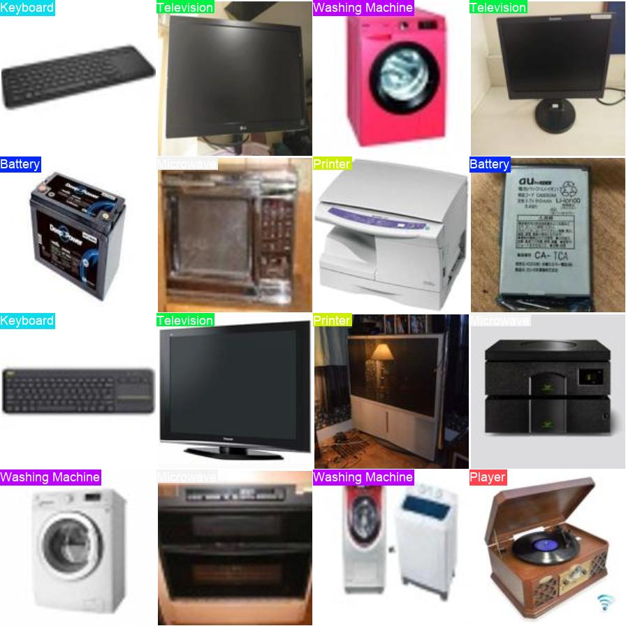

# E-Wise: E-Waste Recycling Platform

> Hackathon prototype for e-waste awareness and pickup: an image classifier for 10 kinds of electronic waste, a multilingual Gemini chatbot, and a Next.js citizen portal.


## Contents

- [Overview](#overview)
- [Highlights](#highlights)
- [Architecture](#architecture)
- [Model results](#model-results)
- [Tech stack](#tech-stack)
- [Project structure](#project-structure)
- [Getting started](#getting-started)
- [Status and known gaps](#status-and-known-gaps)
- [License](#license)

## Overview

**Problem.** Households rarely know which of their old devices count as e-waste, how hazardous they are, or
where to hand them in.

**Approach.** E-Wise combines three pieces built during a hackathon (team *SentinelX*, HackGenX, April 2025):

1. a **YOLOv8m classification model** fine-tuned to recognise 10 categories of e-waste from a photo;
2. a **Gemini-powered assistant** that returns category, hazard level, disposal and recycling advice in the
   user's language;
3. a **Next.js web portal** (marketplace, pickup scheduling, rewards, recycling-centre and education pages),
   plus a small Flask service that sends a WhatsApp notification through Twilio when a pickup is booked.

**Result.** The classifier reaches **0.92 top-1 / 0.997 top-5 accuracy** on a 300-image validation split after
a single training epoch. The web UI is largely a front-end prototype; see [Status and known gaps](#status-and-known-gaps).

## Highlights

- 10-class e-waste image classifier: Battery, Keyboard, Microwave, Mobile, Mouse, PCB, Player, Printer,
  Television, Washing Machine.
- Chat endpoint (`POST /api/chat`) backed by `gemini-2.0-flash`; the UI offers English, Hindi, Spanish, French and
  German, and the backend supports 11 languages.
- CLI mode of the assistant with text-to-speech (gTTS online, pyttsx3 offline fallback).
- Pickup scheduling form that triggers a WhatsApp message to an operator via Twilio.
- Next.js 15 App Router frontend with shadcn/ui components, light/dark themes and analytics charts (Recharts / Tremor).

## Architecture



## Model results

Fine-tuning `yolov8m-cls.pt` (ImageNet-pretrained) on 224 x 224 images, batch 8, Adam (lr 0.001), 1 epoch on an
RTX 3050 Ti laptop GPU (numbers from `model-training/runs/classify/train/results.csv` and the notebook output):

| Split | Images | Top-1 accuracy | Top-5 accuracy | Val loss |
|-------|-------:|---------------:|---------------:|---------:|
| Validation | 300 (30 per class) | **0.920** | **0.997** | 0.264 |

<details>
<summary>Per-class recall (diagonal of the normalised confusion matrix)</summary>

| Class | Recall | Class | Recall |
|-------|-------:|-------|-------:|
| Battery | 0.93 | PCB | 0.87 |
| Keyboard | 0.97 | Player | 0.77 |
| Microwave | 0.97 | Printer | 0.83 |
| Mobile | 1.00 | Television | 0.90 |
| Mouse | 1.00 | Washing Machine | 0.97 |

The weakest classes are *Player* (confused with Mouse and Printer) and *Printer*.

</details>

<p align="center">
  
</p>

<details>
<summary>Validation predictions sample</summary>

<p align="center">
  
</p>

</details>

> The dataset (`datasets/diff-types/`) is not included in the repository, and its source is not recorded here.
> With only one epoch and a 300-image validation split, these figures are indicative rather than a benchmark.

## Tech stack

| Layer | Technology |
|-------|------------|
| Frontend | Next.js 15 (App Router), React 18, TypeScript, Tailwind CSS, shadcn/ui (Radix), Recharts, Tremor, Framer Motion |
| Chatbot service | Python, Flask, Flask-CORS, `google-generativeai` (Gemini 2.0 Flash), gTTS / pyttsx3 (CLI TTS) |
| Notification service | Python, Flask, Twilio WhatsApp API |
| Vision model | Ultralytics YOLOv8m-cls, PyTorch, OpenCV |
| Hosted inference (experimental) | Roboflow serverless inference |

## Project structure

```text
E-Wise__E-Waste-Recyling-Platform/
├── chatbot-service/            # Flask API for the multilingual Gemini assistant
│   ├── app.py                  # POST /api/chat
│   ├── ewaste_assistant.py     # prompt, language table, CLI + text-to-speech
│   ├── requirements.txt
│   └── .env.example
├── notification-service/       # Flask API that sends pickup alerts via Twilio WhatsApp
│   ├── app.py                  # POST /api/schedule-pickup
│   ├── requirements.txt
│   └── .env.example
├── model-training/             # YOLOv8 classification training
│   ├── train.ipynb / train.py  # fine-tuning script and notebook (with outputs)
│   ├── detect.py               # image / webcam inference with a trained model
│   ├── data.yaml               # class names and dataset paths
│   ├── yolov8m-cls.pt          # ImageNet-pretrained base weights (Ultralytics)
│   ├── requirements.txt
│   └── runs/classify/train/    # metrics, plots, weights/best.pt and last.pt
├── e-waste-webapp/             # Next.js frontend
│   ├── app/                    # routes: dashboard, marketplace, rewards, education, ...
│   ├── components/             # UI sections, chatbot widget, shadcn/ui primitives
│   ├── pages/api/infer.ts      # Roboflow inference proxy (experimental)
│   ├── package.json
│   └── .env.example
├── LICENSE
└── README.md
```

## Getting started

### Prerequisites

- Python 3.11, Node.js 18+ and npm
- A Google Gemini API key (chatbot), optionally Twilio WhatsApp sandbox credentials (pickup alerts) and a
  Roboflow API key (`/api/infer`)

### 1. Chatbot service (port 5000)

```bash
cd chatbot-service
python -m venv .venv && source .venv/bin/activate   # Windows: .venv\Scripts\activate
pip install -r requirements.txt
cp .env.example .env        # set GEMINI_API_KEY
python app.py               # serves http://127.0.0.1:5000/api/chat
```

Try it without the UI:

```bash
curl -X POST http://127.0.0.1:5000/api/chat \
  -H "Content-Type: application/json" \
  -d '{"message": "old laptop battery", "language": "hindi"}'
```

Or use the interactive CLI with speech output: `python ewaste_assistant.py`.

### 2. Notification service (port 5001, optional)

```bash
cd notification-service
pip install -r requirements.txt
cp .env.example .env        # Twilio SID, auth token, sender and recipient WhatsApp numbers
python app.py
```

### 3. Web app (port 3000)

```bash
cd e-waste-webapp
npm install
cp .env.example .env.local  # ROBOFLOW_API_KEY, only needed for /api/infer
npm run dev                 # http://localhost:3000
```

### 4. Training and local inference

```bash
cd model-training
pip install -r requirements.txt
# place the dataset under model-training/datasets/diff-types/{train,val,test}/<class>/
python train.py             # saves e-waste-classifier.pt
python detect.py            # image or webcam inference
```

To use the committed checkpoint instead, load `runs/classify/train/weights/best.pt` in `detect.py`.

## Status and known gaps

This is a hackathon prototype and not every screen is wired to a backend:

- **Image upload** (`/dashboard/upload-item`) posts to `http://localhost:5000/analyze`, an endpoint that no
  service in this repo implements; the trained YOLO model is not yet served over HTTP.
- **`pages/api/infer.ts`** calls a Roboflow-hosted model (`e-waste-c8eii/3`), but `@roboflow/inference` is not
  listed in `package.json` and no page calls this route yet.
- **Pickup scheduling** posts to the relative path `/api/schedule-pickup`, so it reaches the Flask
  notification service only behind a proxy or rewrite to port 5001.
- Marketplace, rewards, analytics, login and profile pages use mock data generated with v0; there is no database.
- The web chatbot's text-to-speech button is a placeholder; speech output exists only in the Python CLI.
- `train.py` intends early stopping across 1-epoch `model.train()` calls; the recorded run trained a single epoch.

## License

Code is released under the [MIT License](LICENSE). The base weights and the `ultralytics` package are distributed by
Ultralytics under AGPL-3.0, which also applies to models fine-tuned from them; check those terms before reusing
`best.pt` in a closed-source product.
